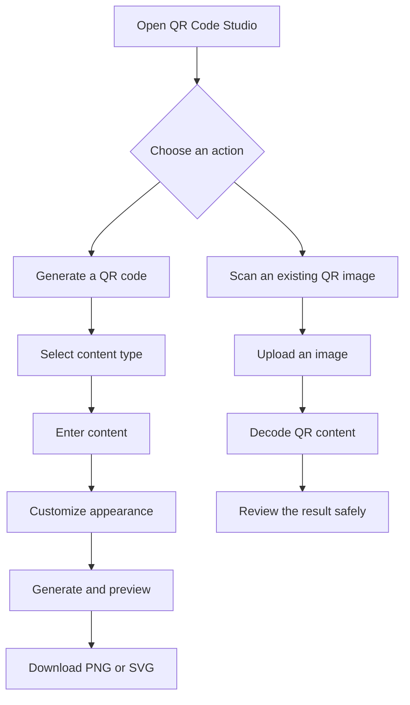

# ▦ QR Code Studio

### Create. Customize. Download. Scan.

**A free, all-in-one QR code generator by [Rumi-Ware](https://github.com/Rumi-Ware).**

Generate QR codes for websites, Wi-Fi networks, contacts, WhatsApp, email, phone numbers, locations, calendar events, and more. Customize their appearance, download them in PNG or SVG format, and scan existing QR codes — all from one simple application.

<p align="center">
  <strong>Free. No login, no subscriptions, no API keys, and no hidden requirements.</strong>
  <br>
  Just open the website, enter your content, generate your QR code, and download it.
</p>

<p align="center">
  
  
  
  
</p>

<p align="center">
  
  
  
  
</p>

---

## ✨ Why QR Code Studio?

Creating and sharing QR codes should be simple. QR Code Studio brings QR generation, customization, and scanning together without requiring accounts or third-party QR generation services.

- 🆓 **Completely free to use** — no subscriptions or paid features.
- 🔓 **No registration required** — start creating QR codes without creating an account.
- 🔑 **No API keys** — no external QR generation API credentials are needed.
- 🎨 **Customizable designs** — choose colors, image size, error correction, and an optional logo.
- 📥 **PNG and SVG downloads** — choose a raster image or a clean vector QR code.
- 📷 **Built-in QR scanner** — upload images and decode QR codes.
- 🔒 **Privacy-conscious processing** — the application processes payloads and uploads in memory without intentionally storing them permanently.
- ⚡ **Simple workflow** — enter, customize, generate, and download.

## 🚀 Features

| Feature | Description |
|---|---|
| QR generation | Generate static QR codes for multiple content types |
| QR customization | Set foreground and background colors |
| Logo support | Add an optional center logo to PNG QR codes |
| PNG export | Generate images from 240 to 1,600 pixels |
| SVG export | Download scalable vector QR codes |
| QR scanning | Decode PNG, JPG, JPEG, and WEBP images |
| Multi-code detection | Attempt to detect multiple QR codes in one image |
| Content classification | Identify common types of decoded QR content |
| Input validation | Validate supported values and image uploads |
| Contrast checks | Warn about potentially difficult-to-scan color combinations |
| Privacy-focused design | No accounts, external QR APIs, or intentional permanent storage |

## 🧩 Supported QR code types

Create QR codes for everyday personal, educational, and business use.

| QR type | What it does |
|---|---|
| 🌐 Website URL | Share a website or web page |
| 📝 Plain text | Share a message or any supported text |
| 📶 Wi-Fi | Share network details for compatible scanners |
| 💬 WhatsApp | Open a WhatsApp chat with an optional message |
| ✉️ Email | Prepare an email with an optional subject and body |
| 📞 Phone call | Make a phone number easy to access |
| 💌 SMS | Prepare a text message |
| 👤 Contact card | Share contact information using vCard |
| 📍 Location | Share a location through a Google Maps search URL |
| 📅 Calendar event | Encode event information using iCalendar |
| 📄 Document link | Share a user-provided document URL |
| 💳 Payment link | Link to a user-provided payment page |

**Please note:** Document and payment QR codes encode links supplied by the user. They do not upload documents or directly process payments through banking providers. Compatibility with Wi-Fi, calendar, SMS, and payment links varies by device and scanner application.

## 🎨 Customize your QR codes

Give your QR codes a look that fits your project or brand.

- **Foreground color:** Customize the QR code's main pattern.
- **Background color:** Choose a background color.
- **Image size:** Generate PNG files between 240 and 1,600 pixels.
- **Quiet zone:** Adjust the clear border around the code.
- **Error correction:** Choose Low, Medium, Quartile, or High.
- **Optional center logo:** Add a logo to PNG exports.

The application checks color contrast and validates supported settings. However, customized codes should always be tested on multiple devices before printing or distribution.

## 🖼️ Screenshots

The following sections are placeholders for real screenshots of the application. Add screenshots after running QR Code Studio locally.

<p align="center">
  <strong>QR Code Generator</strong>
  <br>
  
</p>

<p align="center">
  <strong>QR Code Scanner</strong>
  <br>
  
</p>

To display these images, create the `assets/screenshots/` folder and add your screenshots using the filenames shown above.

## 🔄 How it works



## 🛠️ Technology stack

| Technology | Purpose |
|---|---|
| Python 3.11+ | Application logic |
| Streamlit | Web interface and navigation |
| `qrcode` | QR code generation |
| Pillow | Image processing and PNG output |
| OpenCV Headless | QR code detection and decoding |
| NumPy | Image data processing |
| pytest | Automated testing |

## 💻 Installation and local usage

Run QR Code Studio on your own computer.

### 1. Clone the repository

```bash
git clone https://github.com/Rumi-Ware/QR-code-Generator.git
cd QR-code-Generator
```

### 2. Create a virtual environment

```bash
python -m venv .venv
```

### 3. Activate the environment

**Windows PowerShell**

```powershell
.\.venv\Scripts\Activate.ps1
```

**macOS / Linux**

```bash
source .venv/bin/activate
```

### 4. Install dependencies

```bash
python -m pip install -r requirements.txt
```

### 5. Run the application

```bash
python -m streamlit run app.py
```

Open the local URL printed in your terminal by Streamlit.

No API keys, external QR generation services, or database setup are required for local use.

## 🧪 Run the tests

Run the automated test suite from the project directory:

```bash
python -m pytest -q
```

The tests cover payload construction, validation, QR image generation, scanning, and related edge cases. They are designed to run without network access or API credentials.

## 📁 Project structure

```text
QR-code-Generator/
│
├── app.py                     # Streamlit interface and navigation
├── payloads.py                # QR payload builders and escaping
├── qr_generator.py            # PNG and SVG generation
├── qr_scanner.py              # QR decoding and content classification
├── validators.py              # Input validation and contrast checks
├── requirements.txt            # Python dependencies
│
├── .streamlit/
│   └── config.toml             # Streamlit configuration
│
└── tests/
    ├── test_generator.py
    ├── test_payloads.py
    ├── test_scanner.py
    └── test_validators.py
```

## ☁️ Deployment

QR Code Studio can be deployed using [Streamlit Community Cloud](https://streamlit.io/cloud), subject to the platform's current availability, resource limits, and deployment requirements.

1. Push your repository to GitHub.
2. Open Streamlit Community Cloud and connect your GitHub account.
3. Create an app from the `Rumi-Ware/QR-code-Generator` repository.
4. Select `app.py` as the entry point.
5. Deploy and test the hosted application.

The application does not require API secrets or an external database. Public hosting still means the hosting provider processes requests and uploaded files as part of operating the application.

## 🔒 Privacy and security

Privacy is an important part of QR Code Studio's design.

- **No account system:** No registration or login is required.
- **No external QR API:** QR generation and image decoding use Python libraries.
- **In-memory processing:** Payloads and uploaded images are not intentionally saved as permanent application records.
- **No automatic link opening:** Decoded links are displayed for review rather than opened automatically.
- **Input validation:** Supported inputs and uploaded images are validated.
- **Upload limit:** Scanned images must be 10 MB or smaller.
- **Sensitive Wi-Fi information:** Wi-Fi payload details are hidden in the interface because they can contain passwords.
- **Untrusted content:** Uploaded files and decoded text are not executed by the application.

**Stay safe:** A QR code can contain a malicious link even if it looks legitimate. Check the destination carefully before opening it, and never enter sensitive information on an unexpected page.

When using a hosted deployment, also review the hosting provider's privacy policy and security settings.

## ⚠️ Limitations

- QR codes are static. Their encoded content cannot be changed after printing without replacing the code.
- Webcam scanning, dynamic redirects, analytics, accounts, QR history, and cloud storage are not included in version 1.0.
- SVG exports do not embed the uploaded raster logo.
- Damaged, dense, very small, highly decorated, or low-contrast codes may not scan reliably.
- Wi-Fi, calendar, SMS, and payment behavior depends on the scanner application, device, or payment provider.

## 🗺️ Future improvements

Possible future enhancements include:

- [ ] Browser-camera scanning with explicit permission
- [ ] Batch QR generation and downloads
- [ ] Additional structured QR payload standards
- [ ] More languages and localization
- [ ] Accessibility checks and print-ready layouts

## 🤝 Contributing

Contributions, bug reports, and feature suggestions are welcome.

1. Fork the repository.
2. Create a feature branch.
3. Make your changes.
4. Run the test suite.
5. Submit a pull request describing your changes.

Please keep contributions focused, testable, and consistent with the project's privacy-conscious approach.

## 📜 License

Check the repository for its current license before reusing or redistributing the project. If you intend to publish the project for wider reuse, ensure that the repository contains an appropriate license file.

---

<p align="center">
  <strong>Less hassle. More possibilities. Just QR codes.</strong>
  <br>
  Built by Rumi-Ware with Python and Streamlit.
  <br><br>
  <strong>Free. No login. No subscriptions. No API keys. No hidden requirements.</strong>
</p>
