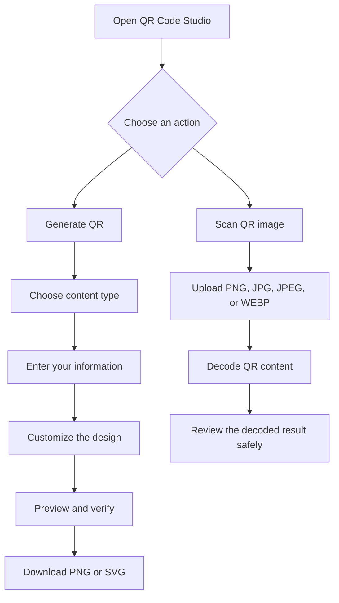

# ▦ QR Code Studio

### Create. Customize. Download. Scan.

**A free, privacy-conscious QR code generator by Rumi-Ware.** Create QR codes for websites, Wi-Fi, contacts, messages, locations, events, and more — all in one simple application.

> **Free. No login, no subscriptions, no API keys, and no hidden requirements.** Just open the website, enter your content, generate your QR code, and download it.

<p align="center">
  <a href="https://github.com/SalmanAliAqdas/qr-code-studio">
    
  </a>
  
  
  
</p>

<p align="center">
  
  
  
  
</p>

---

## ✨ What makes QR Code Studio different?

- **Completely free:** No subscriptions, paywalls, or paid features.
- **No account required:** Start creating QR codes without registration.
- **Privacy-conscious:** QR generation and image scanning run in the application without third-party QR services or external APIs.
- **Customizable designs:** Choose colors, image size, error correction, and an optional center logo.
- **Two download formats:** Export QR codes as PNG or SVG.
- **Built-in scanner:** Upload an image to decode one or multiple QR codes.
- **Simple to use:** Generate and inspect QR codes through a straightforward interface.

## 🚀 Features at a glance

| Feature | What you can do |
|---|---|
| QR generation | Create static QR codes from multiple content types |
| Customization | Adjust foreground and background colors |
| Logo support | Add an optional center logo to PNG codes |
| PNG export | Download raster QR codes up to 1,600 × 1,600 pixels |
| SVG export | Download clean vector QR codes |
| QR scanning | Decode PNG, JPG, JPEG, and WEBP images |
| Multi-code detection | Attempt to scan multiple QR codes from one image |
| Safety checks | Validate inputs, check contrast, and limit uploads |
| Privacy | No accounts, external QR APIs, or intentional permanent storage |

## 🧩 Supported QR code types

Create a QR code for almost any everyday use case.

| QR type | Example use |
|---|---|
| 🌐 Website | Share a website or landing page |
| 📝 Plain text | Display a message or information |
| 📶 Wi-Fi | Let people connect to a wireless network |
| 💬 WhatsApp | Open a chat with an optional prefilled message |
| ✉️ Email | Prepare an email with an optional subject and body |
| 📞 Phone | Make a phone number easy to access |
| 💌 SMS | Prepare a text message |
| 👤 Contact card | Share contact information using vCard |
| 📍 Location | Share a place or address through Google Maps |
| 📅 Calendar | Share an event using iCalendar data |
| 📄 Document | Link to a publicly accessible document |
| 💳 Payment | Link to a payment page supplied by the user |

**Important:** Document and payment QR codes contain links, not the files or money themselves. Payment codes are not direct integrations with banking providers. Scanner compatibility can vary by device and application.

## 🎨 Customization options

Make your QR codes fit your brand or project.

- **Foreground and background colors** — choose your own color combination.
- **Image size** — select a PNG size from 240 to 1,600 pixels.
- **Quiet zone** — adjust the clear border around the code.
- **Error correction** — choose Low, Medium, Quartile, or High.
- **Center logo** — optionally add a logo to PNG exports.

The application warns about poor contrast and attempts to verify generated designs. Always test a customized QR code before printing or sharing it.

## 🖼️ Screenshots

Add real screenshots from the running application to showcase its interface. Save them in the suggested `assets/screenshots/` folder and update the image paths below.

<p align="center">
  <strong>QR Code Generation</strong>
</p>

<p align="center">
  
</p>

<p align="center">
  <strong>QR Code Scanning</strong>
</p>

<p align="center">
  
</p>

## 🔄 How it works



## 🛠️ Technology stack

| Technology | Purpose |
|---|---|
| Python 3.11+ | Application logic |
| Streamlit | User interface |
| `qrcode` | QR code generation |
| Pillow | Image processing and PNG output |
| OpenCV Headless | QR code detection and decoding |
| NumPy | Image data processing |
| pytest | Automated testing |

## 💻 Run locally

You can run QR Code Studio on your own computer without API keys, external QR services, or a database.

### 1. Clone the repository

```bash
git clone https://github.com/SalmanAliAqdas/qr-code-studio.git
cd qr-code-studio
```

### 2. Create a virtual environment

```bash
python -m venv .venv
```

### 3. Activate the environment

**Windows PowerShell**

```powershell
.\.venv\Scripts\Activate.ps1
```

**macOS / Linux**

```bash
source .venv/bin/activate
```

### 4. Install dependencies

```bash
python -m pip install -r requirements.txt
```

### 5. Start the application

```bash
python -m streamlit run app.py
```

Streamlit will display a local URL in your terminal. Open that URL in your browser to start using the application.

## 🧪 Run tests

Run the test suite from the project directory:

```bash
python -m pytest -q
```

The project tests cover QR payload construction, validation, image generation, scanning, and related edge cases. Tests are designed to run without network access or API credentials.

## 📁 Project structure

```text
qr-code-studio/
│
├── app.py                     # Streamlit interface and navigation
├── payloads.py                # QR payload builders and escaping
├── qr_generator.py            # PNG and SVG generation
├── qr_scanner.py              # QR decoding and content classification
├── validators.py              # Input validation and contrast checks
├── requirements.txt            # Python dependencies
│
├── .streamlit/
│   └── config.toml             # Streamlit configuration
│
└── tests/
    ├── test_generator.py
    ├── test_payloads.py
    ├── test_scanner.py
    └── test_validators.py
```

## ☁️ Deployment

QR Code Studio can be deployed using [Streamlit Community Cloud](https://streamlit.io/cloud), subject to that platform's current availability and resource limits.

1. Push the project to GitHub.
2. Open Streamlit Community Cloud and connect your GitHub account.
3. Create an app using this repository.
4. Set `app.py` as the application entry point.
5. Deploy and test the hosted application.

The application does not require API secrets or an external database. However, public hosting still involves the hosting provider processing requests and uploaded files.

## 🔒 Privacy and security

Privacy is an important part of QR Code Studio's design.

- **No account system:** The application does not require user registration or login.
- **No third-party QR API:** QR generation and scanning use local Python libraries.
- **No intentional permanent storage:** Payloads and uploaded images are processed in memory rather than intentionally saved as application records.
- **No automatic link opening:** Decoded URLs are displayed for review rather than opened automatically.
- **Input validation:** The application validates supported inputs and limits uploaded image sizes.
- **Upload restrictions:** Scanned images are limited to 10 MB, and optional logos are limited to 2 MB.
- **Sensitive Wi-Fi details:** The interface hides Wi-Fi payload details because they may contain passwords.

**Stay safe:** A QR code can contain a malicious URL even if it looks legitimate. Verify the destination before opening it, and never enter sensitive information on an unexpected page.

When deploying publicly, review the hosting provider's privacy policy and security settings as well.

## ⚠️ Limitations

- QR codes are static. Their encoded content cannot be changed after printing without replacing the code.
- Webcam scanning, analytics, accounts, QR history, and cloud storage are not included in version 1.0.
- SVG exports do not embed the uploaded raster logo.
- Low-contrast, damaged, very small, dense, or highly decorated codes may be difficult to scan.
- QR behavior for Wi-Fi, calendar events, SMS, and payment links depends on the receiving device, scanner, or provider.

## 🗺️ Future improvements

Potential enhancements include:

- [ ] Browser-camera scanning with explicit permission
- [ ] Batch QR generation and downloads
- [ ] More structured QR payload standards
- [ ] Additional languages and localization
- [ ] Accessibility checks and print-ready layouts

## 🤝 Contributing

Contributions, bug reports, feature suggestions, and improvements are welcome.

1. Fork the repository.
2. Create a feature branch.
3. Make your changes and run the tests.
4. Submit a pull request describing the improvement.

Please keep changes focused, testable, and consistent with the project's privacy-first approach.

## 📜 License

Check the repository for its license before reusing or distributing this project. If you plan to publish it for wider use, include an explicit license file.

---

<p align="center">
  <strong>Less hassle. More possibilities. Just QR codes.</strong>
  <br>
  Built with Python and Streamlit.
  <br><br>
  <strong>Free to use. No login. No subscriptions. No API keys. No hidden requirements.</strong>
</p>
